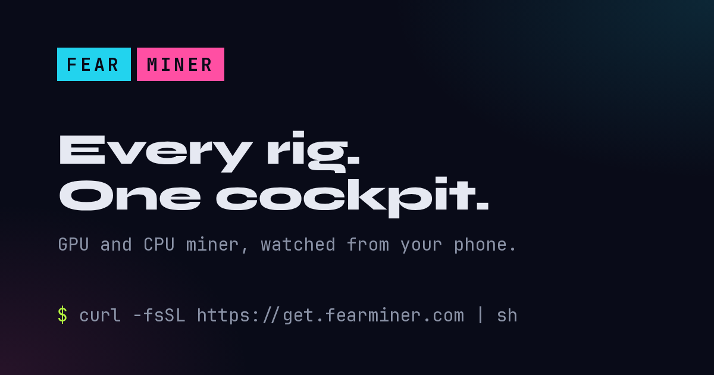
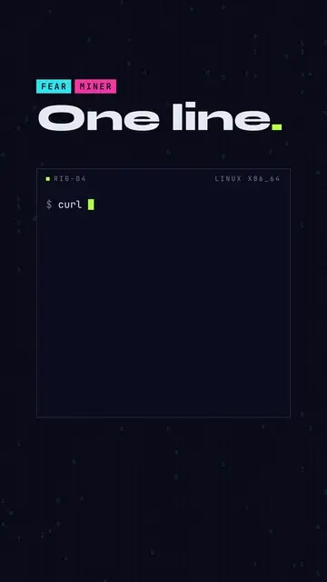
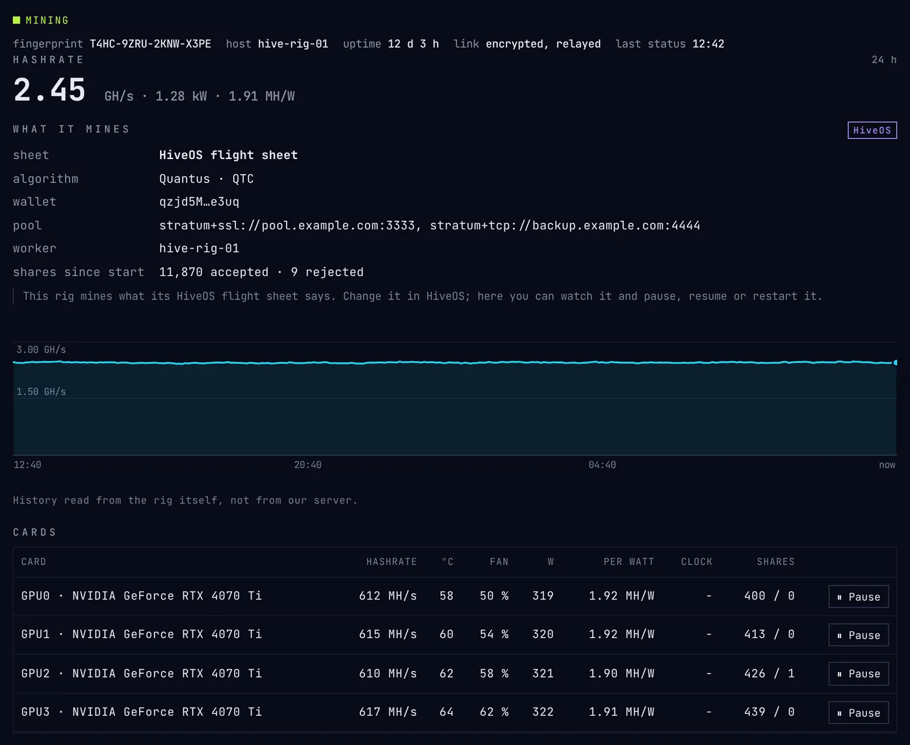

<p align="center">
  <a href="https://fearminer.com"></a>
</p>

GPU and CPU miner. NVIDIA, Apple silicon, CPU. Linux, Windows, macOS,
HiveOS, mmpOS.

**[fearminer.com](https://fearminer.com)** ·
[Start mining, step by step](https://fearminer.com/start/) ·
[Docs](https://fearminer.com/docs/)

<div align="center">
<table>
<tr>
<td align="center"><a href="https://fearminer.com/start/"></a></td>
<td align="center"></td>
</tr>
<tr>
<td align="center"><sub>From zero to mining in 20 seconds</sub></td>
<td align="center"><sub>One line: checked, installed, running</sub></td>
</tr>
</table>
</div>

## Two ways to mine

### With the cockpit

Your whole farm from your phone, at
[app.fearminer.com](https://app.fearminer.com): free, no account. Create
your cockpit, *Add a rig*, paste the line it gives on the rig, then choose
the coin, the wallet and the pool in the cockpit.
[See the demo](https://app.fearminer.com/demo).

```
curl -fsSL https://get.fearminer.com | sh -s -- fm1_...
```

<p align="center">
  
</p>

### Standard, like any miner

Your wallet on your pool, nothing else. Install it as a service:

```
curl -fsSL https://get.fearminer.com | sh -s -- --wallet YOUR_WALLET --pool stratum+ssl://POOL:PORT --worker rig1
```

Or [download](https://github.com/fearminer/fearminer/releases/latest), unpack
and run:

```
./fearminer -a quantus -o stratum+ssl://POOL:PORT -u YOUR_WALLET -w rig1
```

Windows: `irm https://get.fearminer.com/win | iex` ·
HiveOS, mmpOS: [docs/mining-os.md](docs/mining-os.md)

## Algorithms

| Coin | `-a` | Hardware | Fee |
|---|---|---|--:|
| Quantus (QTC) | `quantus` | NVIDIA, Apple, Vulkan, CPU | 1 % |
| Monero (XMR) | `randomx` | CPU | 1 % |
| Pearl (PRL) | `pearl` | NVIDIA RTX 30, 40, 50 | 1 % |
| TensorCash (TSC) | `tensorcash` | NVIDIA, 11 GB of VRAM | 1 % |
| Common Foundry (CMFD) | `commonfoundry` | NVIDIA, 7 GB of VRAM | 1 % |
| Vearl (VRL), testnet | `vearl` | NVIDIA RTX 30, 40, 50, CPU | 1 % |

## Good to know

- NVIDIA driver 550 or newer (570 for RTX 50, 575 for TensorCash).
- Windows and macOS block the first start, the binaries are not signed yet:
  [the fix](docs/install.md#first-run-on-windows-and-macos).
- Your balance is on your pool's dashboard.
- Vearl runs a test network: its coins have no value yet.

The current release is 1.19.0.
**[Download](https://github.com/fearminer/fearminer/releases/latest)**

## Docs

On [fearminer.com/docs](https://fearminer.com/docs/), and here:
[Install](docs/install.md) ·
[Cockpit](docs/cockpit.md) ·
[Options](docs/options.md) ·
[Algorithms](docs/algorithms.md) ·
[HiveOS and mmpOS](docs/mining-os.md) ·
[Security](docs/security.md) ·
[Telegram](https://t.me/FearMiner)
